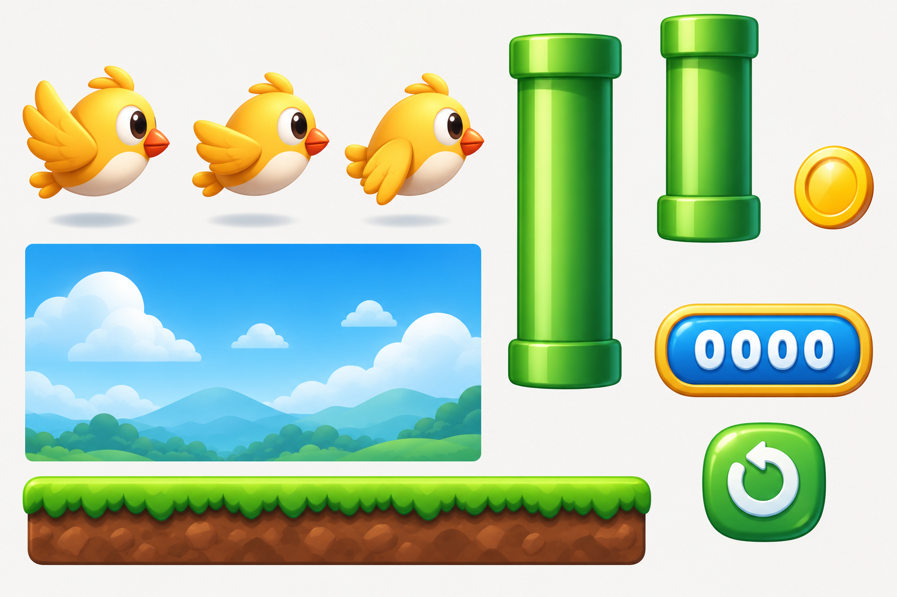

# Modern Flappy Bird Assets

A modern, smooth 3D-cartoon style asset set for a Flappy Bird-inspired game. Everything except the bird is vector (SVG), so it scales to any resolution.

## What is in here

| Folder | Contents |
| --- | --- |
| `assets/birds/` | The bird in three wing poses (`bird_flap_0` wings up, `bird_flap_1` mid, `bird_flap_2` down). Transparent PNGs cut from the original sprite sheet, all on the same canvas and aligned on the beak, so they can be swapped frame by frame without jitter. |
| `assets/svg/` | Vector sprites: pipes, coin, replay button, score badge, ground, sky. |
| `assets/png/` | Transparent PNGs cut directly from the sprite sheet, so they match the original design exactly. `background_sky_loop.png` is still the vector export. |
| `assets/modern-flappy-bird-sprite-sheet.png` | The original concept sheet everything was derived from. |

## Vector sprites

| File | Notes |
| --- | --- |
| `pipe_cap_top.svg` | Pipe end with the opening facing up (a pipe rising from the ground). |
| `pipe_cap_bottom.svg` | Pipe end with the opening facing down (a pipe hanging from the ceiling). |
| `pipe_body.svg` | Pipe shaft. Repeat it vertically to reach any height, there is no seam. |
| `pipe_long.svg`, `pipe_short.svg` | Complete pipes with a cap on both ends, for decoration. |
| `coin.svg` | Collectible coin. |
| `button_replay.svg` | Replay button. |
| `score_badge.svg` | Empty score frame. Draw the score text on top with your own font. |
| `ground_tile.svg` | Grass and soil strip. Repeat it horizontally for a scrolling floor. |
| `background_sky.svg` | Sky, clouds and hills. |
| `background_sky_loop.svg` | The same sky mirrored once, so it repeats horizontally with no seam. |

## Using the assets

- **Building a pipe:** place `pipe_cap_top` at the gap edge, then stack `pipe_body` below it. The body is 164 wide and the caps are 197 wide, so centre the body under the cap. Do the same with `pipe_cap_bottom` for the upper pipe.
- **Scrolling:** move `ground_tile` and `background_sky_loop` left and wrap around. Move the sky slower than the ground for a parallax effect.
- **Animating the bird:** cycle `bird_flap_0`, `bird_flap_1`, `bird_flap_2`, `bird_flap_1`.
- **SVG sizes:** each file has a `viewBox`, so set whatever width and height you need.

## Notes

The bird stays raster because it is the original art from the sheet. The vector sprites are redrawn by hand in the same style, so they are close to the sheet but not pixel-identical.

## Source inspiration

The visual direction was inspired by [samuelcust/flappy-bird-assets](https://github.com/samuelcust/flappy-bird-assets). This is a modern reinterpretation and is not the original pixel-art asset pack.

## License

Released under the [MIT License](LICENSE).
